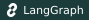
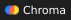

<h1 align="center">Hi, I'm Ati 👋</h1>
<h3 align="center">Data Scientist → building AI agents that actually do things</h3>

  
  
  
  

---

## 🧭 About me

- 🎓 Computer science background, previously a **Data Scientist at Minerva Teknoloji** — data analysis, clustering and time series problems.
- 🤖 Now focused on **agentic AI**: LLM-powered agents with tool use, retrieval, planning and evaluation.
- 🌍 Turkish (native), English (working proficiency).
- 💼 Open to **AI Engineer / Agentic AI Engineer** roles, remote or hybrid.

## 🛠️ Tech stack

**Languages & data**

**ML / Deep learning**

**LLMs & agents**

**Vector databases**

**Tooling**

## 🌱 Currently

- 🔨 Building the **Agent Series** — next up: agentic RAG over my own notes and PDFs
- 📚 Studying **MCP, LangGraph and multi-agent governance**
- 🎯 Goal: production-grade agents — **evals, observability, guardrails**, not just demos

## 📊 GitHub stats

  
  

---

<i>Data scientist by training, agent builder by choice.</i>

